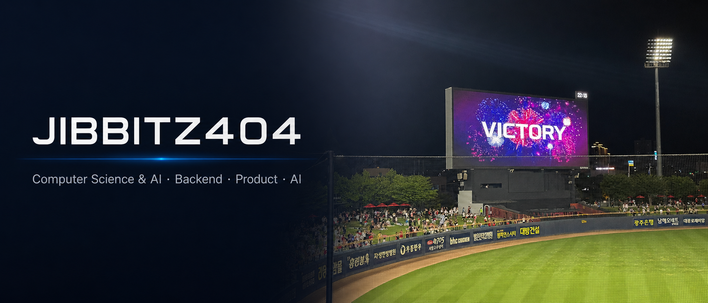

  

 

## 👤 About Me

문제를 발견하면 **기획에서 끝내지 않고 실제로 동작하는 서비스까지 구현하는** 지민준입니다.  

동국대학교 컴퓨터AI학부에서 소프트웨어·AI·데이터를 공부하며  
**서비스 기획, PM, 백엔드, DB·AI 개발** 등 다양한 역할의 프로젝트를 경험하고 있습니다.

팀 프로젝트에서는 서비스 구조와 사용자 흐름을 설계하고 개발 과정까지 연결하는 역할을 주로 맡았으며,  
개인 프로젝트에서는 기획부터 UI 설계, API 연동, 프론트엔드 구현까지 직접 진행하고 있습니다.

기술 자체보다 **“이 기술로 어떤 문제를 해결할 수 있는가”**를 고민하며 프로젝트를 만들어가고 있습니다.

 

## 📋 History

| 기간 | 내용 | 역할 / 결과 |
|:--|:--|:--|
| 2025.03 ~ | 동국대학교 컴퓨터AI학부 재학 | Computer Science & AI |
| 2025.07 ~ 11 | **CAI Roadmap** — 창의문제해결 프로젝트 (NEXCODE) | DB·AI 개발 |
| 2025.11.22 ~ 23 | 동국대학교 첨단융합대학 **X-THON 해커톤** | 서버·백엔드 개발 |
| 2026.01 ~ 02 | **IoTCOSS 사물인터넷 플랫폼 활용 개발자 챌린지** | 🏅 장려상 |
| 2026.04 ~ 05 | **CAISINO × 메이드 주점 테이블오더 시스템** | PM·백엔드 개발 |
| 2026.04 ~ 05 | **동국대학교 SW·AI 가치확산 플랫폼 기획 공모전** | 🏅 우수상 |
| 2026.06 ~ | **AI Smart Campus Challenge** | 이음5G+·AI 서비스 기획 · 본선 진출 |
| 2026.07 | **사물인터넷 혁신융합대학 아이디어톤** | 🏅 우수상 |
| 2026.07 ~ | **Trip Reset** — TourAPI 기반 여행 일정 재구성 서비스 | 1인 기획·개발 |
| 2026.08 | **MBN AI 혁신 해커톤 — Snapin** | PM·서비스 기획 |

 

## 🚀 Projects

### 🗺️ Trip Reset
> 여행 중 발생한 돌발상황에 맞춰 기존 일정을 자동으로 재구성하는 여행 서비스

- 1인 서비스 기획 및 개발
- Next.js · TypeScript 기반 웹 서비스 구현
- TourAPI 관광지 데이터 연동
- 날씨 영향 분석 및 일정 재구성
- 지연 · 피로 · 운영 문제 등 돌발상황 처리
- Leaflet 기반 여행 동선 지도 시각화

### 🎰 CAISINO Table Order
> 축제 주점의 주문부터 게임 보상까지 연결한 통합 테이블오더 시스템

- PM · 백엔드 개발
- 테이블별 QR 주문 흐름 설계
- 입금 확인 → 코인 지급 → 웹게임 보상 구조 연결
- 사용자 등록 · 점수 수정 · 조회 · 랭킹 API 구현
- API 일정, PR 기준, 병합 및 통합 테스트 관리

### 🎓 CAI Roadmap
> 컴퓨터AI학부 학생의 졸업요건과 교과 이수를 관리하는 학업 지원 서비스

- 데이터베이스 · AI 개발
- 졸업요건 및 교과 데이터 구조화
- DB 설계 및 API 구현
- 사용자 맞춤형 기능 핵심 구조 개발

### 🌏 Snapin
> 해외 K-Culture 팬을 위한 AI 한류 뉴스 지도·숏폼 플랫폼

- 2026 MBN AI 혁신 해커톤
- PM · 서비스 기획
- 문제 정의 및 핵심 기능 우선순위 설계
- 뉴스 수집 → 클러스터링 → 팩트 정리 → 다국어 현지화
- 지오태깅 → 숏폼 생성으로 이어지는 AI 파이프라인 기획

 

## 🛠 Tech Stack

**Languages**

**Web**

**Data**

**Tools**

 

## 🏆 Awards

| Date | Competition | Result |
|:--|:--|:--:|
| 2026.02 | IoTCOSS 세종대 사물인터넷 플랫폼 활용 개발자 챌린지 | 🥉 장려상 |
| 2026.05 | 2026 동국대학교 SW·AI 가치확산 플랫폼 기획 공모전 | 🥈 우수상 |
| 2026.07 | 2026학년도 1학기 사물인터넷 혁신융합대학 아이디어톤 | 🥈 우수상 |

 

## 💡 Interests

`Product Management` · `Backend Development` · `AI Service` · `Data` · `Web Development`

 

## 📫 Contact

- GitHub : `@jibbitz404`
- Email : `minjun8707@naver.com`

 

### Build what solves the problem.

